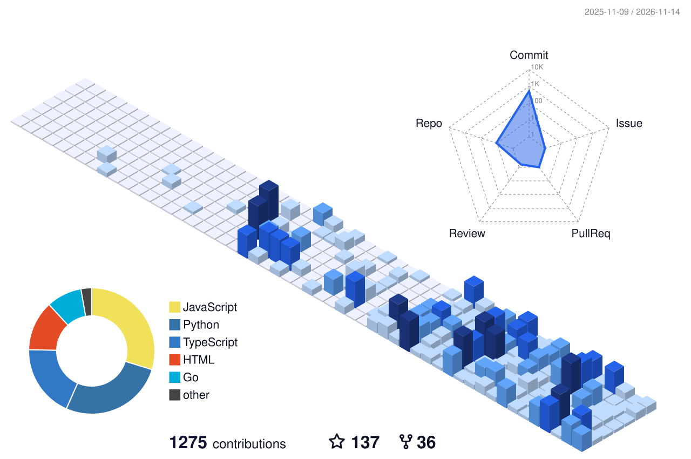

<h1 align="center">
  
  Hi, I'm Basel Husam
</h1>

  <b>Full-Stack AI Engineer</b> · taking <b>LLM</b>, <b>computer vision</b> & <b>MLOps</b> systems from research to production

  
  
  
  
  

---

### 👨‍💻 About me

I'm a **Full-Stack AI Engineer**. I take AI systems all the way from idea to production — the GPU box, the model, the API, and the dashboards that prove it works. My open-source tools have crossed **<!-- stats:total -->46K+<!-- /stats:total --> downloads & pulls**, and I'd rather ship something people run than talk about it.

- 🧠 **LLMs & agents in production** — on-prem RAG and agentic systems on **vLLM**, with tool-calling, memory, and strict validation
- 👁️ **Real-time computer vision** — detection, tracking & pose pipelines over **WebSockets / WebRTC**, deployed to the edge on **NVIDIA Jetson**
- ⚙️ **Infrastructure that holds up** — **Docker Swarm**, **Kafka / GStreamer** streaming, **Prometheus / Grafana** observability
- 🗄️ **Data that fits the problem** — **PostgreSQL**, **MongoDB**, and vector stores (**Qdrant / Milvus**)
- 🛠️ **Open source by default** — exporters, interpretability tools, and CLIs other engineers actually use
- ✍️ Writing at **[BASEL.FM](https://baselhusam.com/fm)** · Portfolio → **[baselhusam.com](https://baselhusam.com)**

---

### 🚀 Featured Projects

| Project | Description |
| :--- | :--- |
| **[daily-hub](https://github.com/baselhusam/daily-hub)**  <!-- stats:daily-hub --><!-- /stats:daily-hub --> | A personal command center for projects, tasks, and daily habits — self-hosted, single-user, **Next.js + SQLite**. [Live demo →](https://baselhusam.github.io/daily-hub/) |
| **[ClickML](https://github.com/baselhusam/ClickML)**   | No-code AutoML platform — build, train, evaluate, and deploy ML models entirely through clicks. |
| **[The Practice of Computing Using Python — Solved](https://github.com/baselhusam/The-Practice-of-Computing-Using-Python-Solved)**  | Worked solutions to the 3rd edition of the book, exercise by exercise. |
| **[qdrant_exporter](https://github.com/baselhusam/qdrant_exporter)**  <!-- stats:qdrant --> <!-- /stats:qdrant --> | Prometheus exporter for self-hosted Qdrant — 34 per-collection, shard & cluster metrics the native `/metrics` endpoint doesn't expose. |
| **[streamlit_arabic_support_wrapper](https://github.com/baselhusam/streamlit_arabic_support_wrapper)**  <!-- stats:streamlit-arabic --><!-- /stats:streamlit-arabic --> | A clean component for perfectly aligning Arabic text in Streamlit apps. |
| **[visionstyle](https://github.com/baselhusam/visionstyle)**  <!-- stats:visionstyle --><!-- /stats:visionstyle --> | Configurable bounding boxes, labels, and tracking trails for object detection — 22 presets, a live Studio editor, and a CLI. |
| **[Face-Blurring](https://github.com/baselhusam/Face-Blurring)**  | Blur faces in images while keeping the rest untouched, using Haar Cascade and YOLOv8. |
| **[damj](https://github.com/baselhusam/damj)**  <!-- stats:damj --><!-- /stats:damj --> | Python package for structured prompt engineering and project-context aggregation. |
| **[open-webui-exporter](https://github.com/baselhusam/open-webui-exporter)**  <!-- stats:open-webui --><!-- /stats:open-webui --> | Prometheus exporter for Open WebUI — polls the REST API (no DB access) and reconstructs per-model cost. |

Stars are live · downloads &amp; pulls (PyPI, npm, Docker Hub, GHCR, Grafana) refresh daily from <a href="https://baselhusam.com">baselhusam.com</a>

---

### 🔧 Tech Stack

**Languages**

**Generative AI & LLMs**

**Deep Learning & Computer Vision**

**Backend & Real-Time Streaming**

**MLOps, Infra & Edge**

**Data & Vector Stores**

---

### 📊 GitHub Stats

  

  <picture>
    <source media="(prefers-color-scheme: dark)" srcset="https://raw.githubusercontent.com/baselhusam/baselhusam/output-3d-contrib/night.svg" />
    <source media="(prefers-color-scheme: light)" srcset="https://raw.githubusercontent.com/baselhusam/baselhusam/output-3d-contrib/day.svg" />
    
  </picture>

### 📈 Contribution Graph

<picture>
  <source media="(prefers-color-scheme: dark)" srcset="https://raw.githubusercontent.com/baselhusam/baselhusam/output/github-contribution-grid-snake-dark.svg" />
  <source media="(prefers-color-scheme: light)" srcset="https://raw.githubusercontent.com/baselhusam/baselhusam/output/github-contribution-grid-snake.svg" />
  
</picture>

